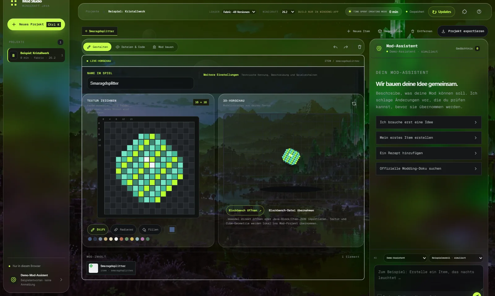
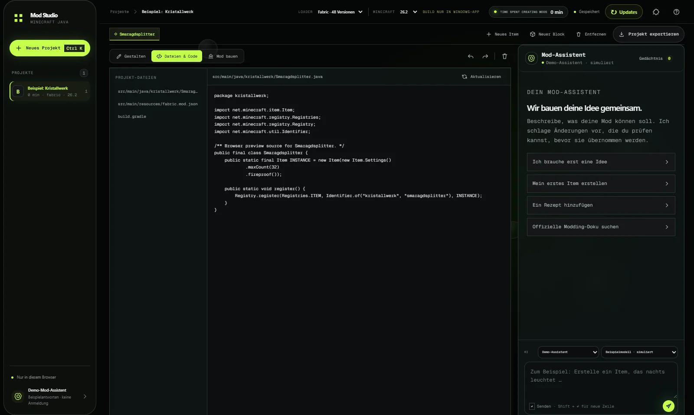

<div align="center">



# Mod Studio

### Turn your idea into an editable Minecraft Java mod project.

[](https://github.com/LvisXVI/minecraft-mod-studio/releases/latest)
[](https://github.com/LvisXVI/minecraft-mod-studio/releases/latest)
[](docs/PROJECT_STATUS.md)

[🌐 Website](https://lvisxvi.github.io/minecraft-mod-studio/) · [🧪 Browser demo](https://lvisxvi.github.io/minecraft-mod-studio/demo/) · [⬇️ Download for Windows](https://github.com/LvisXVI/minecraft-mod-studio/releases/latest) · [📋 Project status](docs/PROJECT_STATUS.md) · [🗺️ Roadmap](docs/ROADMAP.md)

</div>

---

Mod Studio is a local workbench for Minecraft Java mods. Describe your idea, paint real 16×16 textures, bring in Blockbench models, edit properties and Java source, and build the project right on your PC. AI is optional: sign in with ChatGPT or use a local Ollama model.

> **Also included in [Modspire 0.3.3](https://lvisxvi.github.io/modspire/):** Modspire launches the real Mod Studio from any of its five layouts, with no separate installation.

> The app interface is currently in German; this documentation is in English.

## ✨ What you can build today

| | |
|---|---|
| 🎨 **16×16 textures** | Pen, eraser, fill, palette and a live 3D preview – every stroke goes straight into the project texture. |
| 🧊 **Blockbench** | Open `.bbmodel` files or import Java block/item JSON; texture and cube geometry are imported locally. |
| ☕ **Java & resources** | Properties, Java source, `fabric.mod.json` and Gradle files side by side in the workbench. |
| 🔨 **Build** | Build a Fabric JAR for **Minecraft Java 26.2** or export the source project as a ZIP. JDK and Gradle are bundled. |
| 🧠 **Mod assistant** | Version-aware explanations, official documentation search on explicit request, and a local, editable memory of your preferences. |
| 🪟 **Two surfaces** | *Liquid Glass* (default: frosted panels over a Minecraft world) or *Workshop* (clear, high contrast) – switch with one click in the top bar; six animated backgrounds under **Background**. |

<p align="center"></p>

Forge, NeoForge, Quilt, more Minecraft versions and more content types are on the roadmap and are not enabled as buildable targets yet. The [project status](docs/PROJECT_STATUS.md) separates verified features from the [roadmap](docs/ROADMAP.md).

## 🚀 Install

1. Open [Releases](https://github.com/LvisXVI/minecraft-mod-studio/releases/latest).
2. **`Mod-Studio-Setup.exe`** installs the app and its runtimes into `%LOCALAPPDATA%\Programs\ModStudio` – or unzip **`Mod-Studio-Portable.zip`** and run `Mod-Studio.exe`.
3. Create a project, paint your first texture, build.

Projects and credentials stay local in `%LOCALAPPDATA%\ModStudio`; the app server binds to `127.0.0.1`. Sign-in and the first build need internet access (Gradle downloads the official Minecraft/Fabric dependencies).

## 🧪 Try it in your browser

The [browser demo](https://lvisxvi.github.io/minecraft-mod-studio/demo/) is the real editor interface. Projects stay in your browser, assistant replies are simulated, and Java builds need the Windows app.

## 🛠️ Development

Node.js 20+. Tailwind is compiled locally; the server only uses Node built-ins.

```bash
npm install
npm run css:build
npm start
npm test
```

```bash
npm run demo:build      # browser demo into docs/demo/
npm run dist:portable   # dist/Mod-Studio-Setup.exe, Mod-Studio-Portable.zip, SHA256SUMS.txt
```

Licence and checksum notes for the bundled runtimes are in [`licenses/`](licenses/).

## 🌐 The project family

[Modspire](https://lvisxvi.github.io/modspire/) plans modpacks, **Mod Studio** builds mods, [Minecraft Host](https://lvisxvi.github.io/minecraft-host/) runs the server for your friends. Each website has a switcher at the top to jump between them.

Mod Studio is an independent community project and is not affiliated with Microsoft or Mojang.
