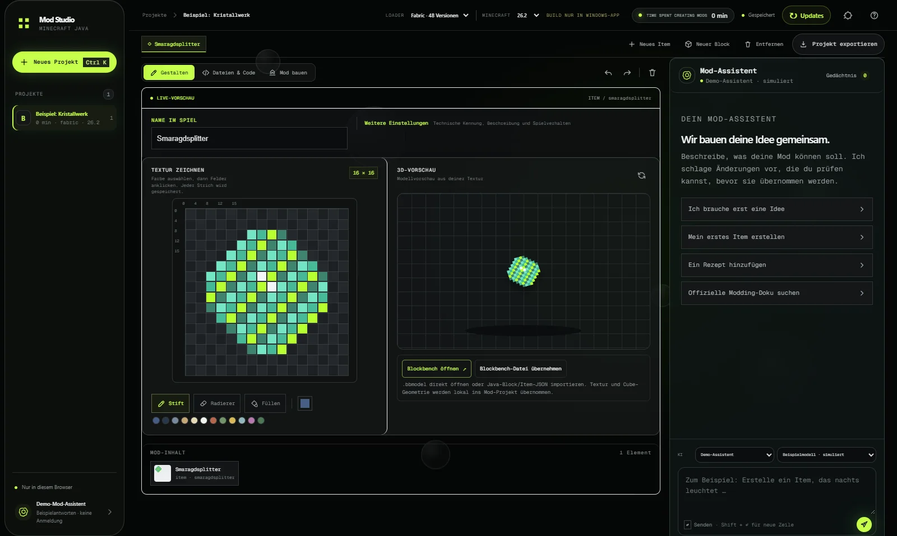

<div align="center">



# Mod Studio

### Deine Idee wird zum editierbaren Minecraft-Java-Projekt.

[](https://github.com/LvisXVI/minecraft-mod-studio/releases/latest)
[](https://github.com/LvisXVI/minecraft-mod-studio/releases/latest)
[](docs/PROJECT_STATUS.md)

[🌐 Website](https://lvisxvi.github.io/minecraft-mod-studio/) · [🧪 Browser-Testversion](https://lvisxvi.github.io/minecraft-mod-studio/demo/) · [⬇️ Windows herunterladen](https://github.com/LvisXVI/minecraft-mod-studio/releases/latest) · [📋 Projektstatus](docs/PROJECT_STATUS.md) · [🗺️ Roadmap](docs/ROADMAP.md)

</div>

---

Mod Studio ist eine lokale Werkbank für Minecraft-Java-Mods. Beschreibe deine Idee, zeichne echte 16×16-Texturen, übernimm Blockbench-Modelle, bearbeite Eigenschaften und Java-Quelltext und baue dein Projekt direkt auf deinem PC. KI ist optional: ChatGPT-Anmeldung oder ein lokales Ollama-Modell.

> **Auch in [Modspire 0.3.2](https://lvisxvi.github.io/modspire/) enthalten:** Modspire startet das echte Mod Studio aus jedem seiner fünf Layouts, ohne separate Installation.

## ✨ Was du heute bauen kannst

| | |
|---|---|
| 🎨 **16×16-Texturen** | Stift, Radierer, Füllen, Palette und Live-3D-Vorschau – jeder Strich landet direkt in der Projekttextur. |
| 🧊 **Blockbench** | `.bbmodel` öffnen oder Java-Block/Item-JSON importieren; Textur und Cube-Geometrie werden lokal übernommen. |
| ☕ **Java & Ressourcen** | Eigenschaften, Java-Quelltext, `fabric.mod.json` und Gradle-Dateien direkt in der Werkbank ansehen. |
| 🔨 **Bauen** | Fabric-JAR für **Minecraft Java 26.2** bauen oder das Quellprojekt als ZIP exportieren. JDK und Gradle sind im Paket. |
| 🧠 **Mod-Assistent** | Versionsbewusste Erklärungen, offizielle Doku-Suche auf ausdrückliche Bitte und ein lokales, bearbeitbares Gedächtnis. |
| 🪟 **Zwei Oberflächen** | *Werkstatt* (klar, kontraststark) oder *Liquid Glass* (Milchglas über einer Minecraft-Welt) – unter **Hintergrund** wählbar, dazu sechs animierte Hintergründe. |

<p align="center"></p>

Forge, NeoForge, Quilt, weitere Minecraft-Versionen und Inhaltstypen sind Ausbauziele und noch nicht als baubare Adapter freigeschaltet. Der [Projektstatus](docs/PROJECT_STATUS.md) trennt Geprüftes klar von der [Roadmap](docs/ROADMAP.md).

## 🚀 Installation

1. [Releases](https://github.com/LvisXVI/minecraft-mod-studio/releases/latest) öffnen.
2. **`Mod-Studio-Setup.exe`** installiert App und Laufzeiten unter `%LOCALAPPDATA%\Programs\ModStudio` – oder **`Mod-Studio-Portable.zip`** entpacken und `Mod-Studio.exe` starten.
3. Projekt anlegen, erste Textur zeichnen, bauen.

Projekte und Zugangsdaten bleiben lokal unter `%LOCALAPPDATA%\ModStudio`; der App-Server bindet an `127.0.0.1`. Anmeldung und erster Build brauchen Internet (Gradle lädt die offiziellen Minecraft-/Fabric-Abhängigkeiten).

## 🧪 Im Browser ausprobieren

Die [Browser-Testversion](https://lvisxvi.github.io/minecraft-mod-studio/demo/) ist die echte Editor-Oberfläche. Projekte bleiben im Browser, Assistentenantworten sind simuliert, Java-Builds gibt es nur in der Windows-App.

## 🛠️ Entwicklung

Node.js 20+. Tailwind wird lokal kompiliert, der Server nutzt Node-Bordmittel.

```bash
npm install
npm run css:build
npm start
npm test
```

```bash
npm run demo:build      # Browser-Testversion nach docs/demo/
npm run dist:portable   # dist/Mod-Studio-Setup.exe, Mod-Studio-Portable.zip, SHA256SUMS.txt
```

Lizenz- und Prüfsummenhinweise zu den gebündelten Laufzeiten stehen in [`licenses/`](licenses/).

## 🌐 Die Projektfamilie

[Modspire](https://lvisxvi.github.io/modspire/) plant Modpacks, **Mod Studio** baut Mods, [Minecraft Host](https://lvisxvi.github.io/minecraft-host/) startet den Server für deine Freunde. Oben auf jeder Website wechselst du zwischen den drei Projekten.

Mod Studio ist ein unabhängiges Community-Projekt und nicht mit Microsoft oder Mojang verbunden.
